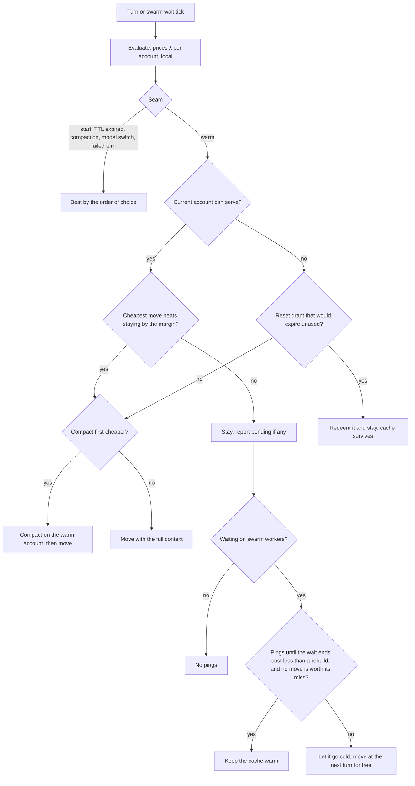

# Routing policy: accounts, egress, budgets (plan)

Fork-only. Multi-account routing across providers, per-provider and per-account
egress proxies, account priorities, and usage/spend limits, all described in
`config.toml`. The daemon decides which credential serves each session.

## Design decisions

| Question | Decision |
| --- | --- |
| Where routing runs | Natively in the daemon. One process sees every session, so intents, meter samples and the spend ledger have one owner. |
| Limit reached | Configurable per account and per budget: `switch`, `ask` or `block`. Default: ask in an interactive session through an inline view like `ask`, block with a reason in headless sessions and subagents. |
| Egress proxy down | Per proxy. `required = true` fails closed (the account is unavailable and routing picks the next), `false` goes direct. |
| Config format | `[routing]`, `[egress.*]`, `[[routing.accounts]]`, `[[routing.budgets]]` in `config.toml`. Mutable state lives in a daemon store. `account-pool.json` is migrated and deleted. |
| Providers covered | Claude subscriptions and API credits, OpenAI subscriptions and Codex credits, Cursor dollar pool, OpenCode Go (several keys), Hugging Face Inference Providers billed to an organization, named OpenAI-compatible providers. |

## Behaviour

- **Account kinds.** `subscription` (rate windows such as 5h and 7d), `credits` (a prepaid or monthly grant), `metered` (pay per token).
- **Priority.** A number, or a map by model class (`{ fable = 1, default = 2 }`), so sessions on different model families can prefer different accounts. Lower wins. Accounts in one priority group are load balanced.
- **Model globs.** An account serves only the models it lists, so routing never sends a model to an account that cannot run it.
- **Model-scoped windows.** A per-family weekly window only counts for that family.
- **Adaptive limit.** Leave an account when what is left no longer covers the measured burn rate over a horizon, bounded by a ceiling and a floor. Unknown rate falls back to the ceiling.
- **Drain before reset.** Falls out of the order of choice: a pool whose room the measured burn will not use before its reset goes ahead of priority (see Pools).
- **Pacing.** Every pool lost at a reset, including a credit grant, is paced to be spent by its own reset, with `pacing_slack_pct` as hysteresis for the current account so the boundary does not flap.
- **Subagent reserve.** Subagents leave an account a few points earlier than the interactive session.
- **Paid intent.** `auto` (pacing and last-resort fallback), `off` (paid accounts only by explicit choice), `allow <duration>`.
- **Intents.** `pin` (session and its children), `switch` (this session), `hold` (all interactive sessions until expiry), `unstick`, `ack` (keep spending here for a while).
- **Health eviction.** N consecutive failures evict an account for a duration. A `required` egress that is down evicts its accounts.
- **Unreadable meters never disqualify** and are shown as unknown, never as zero.
- **Cache seams.** Moves happen at session start and at cache-cold seams. A warm session moves only when the economics below say the move pays for its cache miss.
- **Grant health.** Idle OAuth accounts get a periodic refresh probe, and an approaching login expiry warns ahead of time.

## Economics: cache, resets and keepalive

Routing is evaluated on every turn because limits move during a session and a
cache can go cold between turns. Evaluation is local and costs nothing.
Applying a move is rare, because leaving a warm cache rewrites the whole
context on the new account.

### Pools

Every account spends from one or more pools. A pool has a capacity, what is
used, a reset time, and whether its unused room is lost at the reset.

- Subscription windows (5h, 7d, model-scoped), read from the provider's meter.
- Credit grants: a monthly cash or credits allowance (for example $600 or 150
  credits a month) with its own reset date. The provider's meter supplies used
  and capacity when it can; otherwise a budget on that account supplies the
  capacity, and the person can set the reset anchor (`month@15` resets on the
  15th). These grants are lost at their reset, exactly like a window.
- Reset grants (weekly limit resets, banked resets) with their expiry.
- Metered API money has no reset and loses nothing when unused.

Every pool whose room is lost at a reset is paced to be spent fully by that
reset. Two credit accounts of $600 and $150 with different reset dates both
run, each at the rate its own room and time left allow.

### Order of choice

The cheapest account means, in order:

1. **Room that would be lost.** A pool behind its pace line (the measured burn
   will not use its room before the reset) goes first, soonest reset first.
   This is the only thing that beats priority, because the alternative is
   throwing quota away.
2. **Priority.** The person's order, per model class.
3. **Price.** Within one priority, the lowest `λ`.

The same order picks the target of every move and every cold seam.

### Prices

Every account has a shadow price `λ`: what one unit of its quota is worth right
now. All costs below are tokens times a factor times `λ`.

- **Free room.** Room that would expire unused has `λ = 0`: pool room the
  measured burn will not reach before the reset, plus any reset grant that would
  expire before the account could hit its wall again.
- **Expiring pools ahead of pace.** `λ` is scarcity: projected demand until the
  reset divided by the room left. It rises as the pool runs out.
- **Metered.** `λ` is the money price times the account's weight.
- **Cache factors** per provider and tier: Anthropic writes cost 1.25x (5m) or
  2x (1h) of input and reads 0.1x. OpenAI-style caches have no write premium
  and read at the catalog's cached-input ratio. A move pays `context x write`
  on the target. A warm turn pays `context x read` on the current account.

### Options when a move is wanted

`C` is the cached context, `H` the expected tokens until the next natural cold
seam (recent tokens per turn times expected turns), `S` the summary size.

| Option | Cost |
| --- | --- |
| Stay | `H x λcur`, infinite if the current account cannot serve |
| Redeem a reset on the current account | free when the grant would otherwise expire unused; the cache survives |
| Move | `C x write x λnew + H x λnew` |
| Compact, then move | compaction on the warm current account (`C x read x λcur` plus summary output) `+ S x write x λnew + H x λnew` |

Routing picks the cheapest option. Moving needs a margin (hysteresis) over
staying, so it does not flap. Compaction before a move runs automatically when
it is the cheapest option, and the transcript records it.

### Rules

1. A cold seam moves for free: session start, an expired cache TTL, right after
   a compaction, after a model switch, and after a failed turn.
2. A warm session moves only when staying costs more than the cheapest move by
   the margin, or when a person pins or switches.
3. A short rate limit (a 429 with a retry-after within about a minute) retries
   on the same account. Exhausted quota or a broken credential moves at once.
4. At the wall, try in order: redeem a reset that would expire unused,
   `ack` or paid on the same account, the cheapest move. Interactive sessions
   see the remaining choices in a gate. Subagents and headless runs get the
   cheapest automatic option or a block.
5. Reset grants are never wasted. Ten minutes before a grant expires it is
   redeemed if that restores any used quota. Until then, routing counts the
   grant as free room on its account so load drains there first.
6. Keepalive pings run only while the agent waits on swarm workers. Each ping
   costs `C x read x λcur`. Pinging continues while the expected pings until
   the wait ends cost less than rebuilding the cache. On an account with
   free room, pings cost nothing and always run. When a pending move is worth
   its miss, pinging stops, the cache goes cold, and the move becomes free.
7. Children start on their parent's account when it can serve them, so they
   share the cached system and tool prefix.



## Data model

```toml
[egress.corp]
url = "http://127.0.0.1:8899"
required = true
probe = "tcp"

[routing]
mode = "auto"                   # auto | shadow (log decisions, act on none) | off
paid = "off"                    # auto | off
subagent_reserve_pct = 5

[[routing.accounts]]
id = "claude:team"              # provider:label
kind = "subscription"
priority = { fable = 1, default = 2 }
models = ["claude-*"]
egress = "corp"
on_limit = "switch"             # switch | ask | block

[[routing.accounts]]
id = "opencode-go:second"
kind = "subscription"
priority = 3

[[routing.accounts]]
id = "huggingface"
kind = "metered"
priority = 5

[[routing.budgets]]
name = "hf-month"               # stable; ledger usage is recorded under it
provider = "huggingface"        # exactly one of account, provider, model (glob)
meter = "ledger"                # provider (live meter) | ledger (local priced usage)
window = "calendar-month"       # 30m | 5h | 7d | 2w | calendar-month
unit = "usd"                    # percent | usd | credits | tokens
warn = 90
limit = 100
action = "ask"                  # audit | switch | ask | block
```

Parse-time validation reports every problem at once and never breaks loading the
rest of the config: unknown egress or account, duplicate ids or budget names, a
budget with zero or several scopes, a ledger budget in percent or credits, percent
above 100, `warn` above `limit`.

The effective action at a limit is the strictest of the account's `on_limit` and
the budget's `action`. `ack` clears `ask` limits for a while, never `block`.
Phase 6 added hysteresis and eviction settings. The economics add
`move_margin_pct` (default 20), `horizon_turns` (default 10), an account
`weight` (default 1) and month windows anchored on a day (`month@15`). Phase 3
adds `key_command`.

## Engine

A pure crate, `jcode-routing-policy`:

```text
decide(policy, meters, intents, request { model, role, session }, now) -> Decision
Decision = Use { account, reason } | Gate { options, reason } | Block { reason }
```

Order: `pin`, `switch`, `hold`, drain candidates, subscriptions by priority for the
request's model class below their adaptive limit, credits behind their month line,
credits as last resort if `paid` allows, then the account's `on_limit`. Evicted
accounts are skipped.

## What exists today

- `jcode-routing-policy`: validated policy, pure `decide`, pools with pace lines, shadow prices, the option table (stay, redeem, move, compact-then-move) with a move margin, the ten-minute grant sweep and the keepalive outlook. Time-stepped tests per rule, and `scripts/mutate_routing_economics.py` mutation-checks one assertion per rule.
- Routing service in the daemon: shadow and auto modes, gates (switch, compact + switch, redeem reset, wait, ack), headless block, health eviction, burn persistence. Reset grants come from cached Claude and OpenAI reset metadata. A wall or sweep redemption reuses the provider's claim code and its cross-agent lock, and a claim is tried once per grant. Children start on the parent's account. A compact-then-move compacts on the warm account first and says so in the move's transcript line.
- Cache keepalive pings only while a session waits on swarm workers, gated by rule 6 (`docs/prompt-cache-keepalive.md`).
- Multi-account OAuth for Claude and OpenAI (`auth/account_pool.rs`), labelled API keys, egress proxies, budgets and the spend ledger, usage windows for Claude, OpenAI, OpenCode Go and Cursor.
- Missing: a fixture source for reset grants in the daemon acceptance script (real grants only come from provider reset metadata), Codex credit and Cursor pool endpoints.

## Phases

Each phase ends in a check that runs on fixtures.

1. **Types and engine.** Done: `crates/jcode-routing-policy` (raw config, validated `Policy`, pure `decide`), `[routing]` and `[egress.*]` on `Config`. Check: `justrust test -p jcode-routing-policy`.
2. **Egress.** Named proxies, one shared client per egress, assignment per provider and account, fail-closed, probe. Check: a loopback CONNECT proxy fixture sees only the assigned account's requests, and a required account is skipped while the proxy is down.
3. **Several credentials per API-key provider.** Labelled keys for OpenCode Go, Hugging Face and named providers, `key_command`, per-model cost and compat overrides. Check: two OpenCode Go fixture keys with different `/usage` payloads both appear in `/account` and `/usage`.
4. **Meters, ledger, budgets.** One meter view over provider windows (Claude, OpenAI, OpenCode, Codex credits, Cursor pool) and the local priced ledger. Check: fixture spend crosses `warn`, then `limit`, and the verdict changes.
5. **Engine in the daemon.** Account choice at session start and seams, failover through the engine, gate view in the TUI and headless block, `/acct` and `jcode acct status|paid|prefer|pin|unstick --json`, account chip in the header, `account-pool.json` migration. Check: isolated daemon with fixture providers and a driven gate view.
6. **Strategies.** Adaptive limit, drain, month-line pacing, subagent reserve, health eviction. Check: time-stepped engine tests on recorded meter series.
7. **Shadow rollout.** `routing.mode = "shadow"` logs the decision per turn without acting, then `auto`.

## Open items

- Which endpoints report the Cursor pool and Codex credits.
- A per-pane config overlay, so one pane can run a different role-model profile.
- Burn-rate samples must survive daemon reload.
