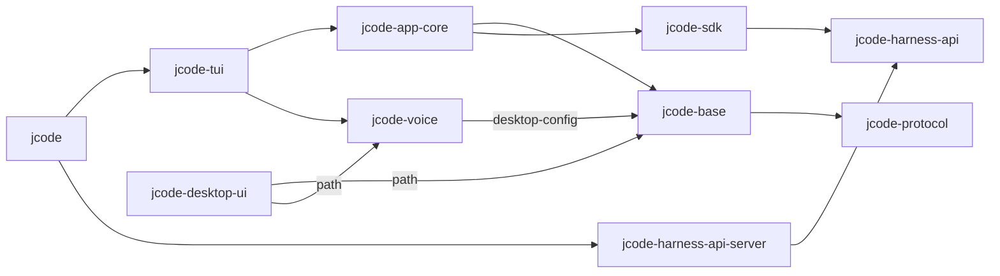

# Время и размер сборки Jcode, 21 ноября 2026

База CLI: `6bbcc7485a287ace2750e4c185b12157a3152a8c`. База Desktop: `dbc14d16b6f0201375acdadd5564c1f14f1abfbf`. Измерения не затрагивали установленное приложение, общий демон или их хранилище сессий.

## Метод

- Нативный `aarch64-apple-darwin`, Rust/Cargo 1.100.0, 14 логических ядер. Два слота `justrust`, текущие Cargo features (`pdf`, `bedrock`), профиль `dev`, четыре задания Cargo. `--locked` фиксирует зависимости. `--rerun` исключает переиспользование вердикта целого запуска. Контроль и опыт запускаются последовательно, не на двух одновременных сборках. Другие задачи на машине не останавливали.
- Холодный прогон означает отсутствующий каталог артефактов, но уже скачанные registry/git sources. Первый разведочный прогон использовал штатный общий depcache. Для профилей контроль и опыт получают отдельные пустые каталоги и отключённые кеши `justrust` (пример ниже).
- Прогретый прогон сначала проверяет no-op. Затем трижды меняется mtime одного и того же `crates/jcode-base/src/config/default_file.rs`. Это прокси инвалидации Cargo, а не замер произвольной правки Rust, и rustc имеет право переиспользовать результаты внутри крейта. Файл входит в число наиболее часто изменявшихся за последние 150 коммитов. Каждый прогон проверяется по `Rebuilt because`, числу юнитов и наличию timing HTML.
- Измеряем `/usr/bin/time -p` (`real`) и `du -sk` одной командой на ARM Mac. Размеры в GiB: KiB, делённые на 1 048 576. Cargo показывает длительность юнита с ожиданием ресурсов, а `justrust show` использует собственные интервалы наблюдения процессов. Длительности отдельных юнитов перекрываются, их нельзя сложить и выдать за время пользователя.

```sh
export JUSTRUST_SLOTS=2 JUSTRUST_DEPCACHE=0 JUSTRUST_LOCALCACHE=0 JUSTRUST_PEER_CACHE=0
# Выполнять в отдельном worktree. RUN_TARGET должен быть новым для холодного прогона.
/usr/bin/time -p justrust build --local='native Darwin compile and disk measurement' \
  --rerun --locked --timings --target-dir "$RUN_TARGET" -j 4 -p jcode --bin jcode
scripts/compile_time_probe.sh --skip-build --timing-html "$RUN_TARGET/cargo-timings/cargo-timing.html"
du -sk "$RUN_TARGET/debug/build" "$RUN_TARGET/debug/incremental" "$RUN_TARGET/debug/jcode" "$RUN_TARGET"
```

## База

`justrust profile --here --days 7` на основном checkout нашёл 545 прогонов: p50 14,48 с, p90 68,79 с, 79,3% суммарного ожидания пришлось на компиляцию. Это смесь команд, машин и состояний кеша. `justrust show` у медленных прогонов `20261115-162141193-36934`, `20261118-171646025-89527`, `20261118-171958956-28954`, `20261118-201239131-62173` показывает, что они не были чистыми замерами одной правки: они пересобирали сотни внешних юнитов. `justrust split --days 7` распознал правки в 297 прогонах (2 959 с компиляции затронутых крейтов и потомков), но его рекомендации по использованию символов нужно сверять с исходниками.

| Разведка со штатными кешами | Wall, с | Компилируемые юниты | Target после cold |
| --- | ---: | ---: | ---: |
| Пустой target, 653 cache hits / 4 misses по depcache | 260,12 | 754 (`justrust`) | 7,03 GiB |
| No-op | 3,36 | 0 | |
| `config/default_file.rs` (base), три прогона | 13,16 / 9,72 / 8,48 | 17 на прогон; 13 localcache hits | |
| `agent.rs` (app-core), один прогон | 4,72 | 4; 3 localcache hits | |
| `tui/ui_messages.rs` (TUI), один прогон | 3,48 | 3; 2 localcache hits | |

В `cargo --timings` холодная сборка 260,00 с. Крупные юниты на критической цепи: `jcode-base` 132,77 с (57,45 до метаданных / 75,32 codegen по разбору HTML), `jcode-app-core` 132,87 с (89,11 / 43,76), `jcode-tui` 55,10 с (36,48 / 18,62), корневая библиотека 22,30 с, бинарь 6,69 с. Они перекрываются, но вместе занимают 232 с от старта base до конца корневой библиотеки. `justrust show 20261121-183034630-65756` также ставит app-core, base и TUI первыми. В холодном `target` 4,50 GiB в `debug/build`, 2,09 GiB в `debug/incremental`, бинарь около 448 MiB. Исторические 9,3/6,1/5,9/2,6 ГБ из общего каталога не сравниваются с одним пустым `target`: там могли накопиться артефакты других feature-наборов, профилей и поколений.

### Связность и размеры

По `cargo metadata --locked --no-deps --format-version=1`: 93 пакета workspace, 288 объявленных прямых рёбер normal path (включая optional и target-specific). `scripts/compile_isolation_report.py` считает тесты вместе с продукционным Rust:

| Крейты | LOC Rust | Файлы | Прямые workspace deps | `derive` | `async_trait` |
| --- | ---: | ---: | ---: | ---: | ---: |
| `jcode-tui` | 309 417 | 642 | 30 | 476 | 26 |
| `jcode-app-core` | 230 598 | 508 | 30 | 395 | 177 |
| `jcode-base` | 195 109 | 405 | 41 | 670 | 34 |
| `jcode` | 57 487 | 119 | 21 | 158 | 5 |
| `jcode-desktop-ui` (sibling checkout) | 173 143 | | | | |

Самые большие группы CLI: `app-core/server` 102 817 строк, `app-core/tool` 69 770, `base/auth` 30 392, `base/provider` 27 039. Из одиночных файлов: `tui/ui_messages.rs` 4 543 строки, `tui/app/input.rs` 4 301, `harness-api-server/translate.rs` 4 271, `app-core/server/client_lifecycle.rs` 4 176. В Desktop `workspace.rs` 17 134, `panel.rs` 12 678, `input.rs` 7 561. LOC не определяет ценность разреза: например, `base/usage` имеет прямые обращения к provider, auth и двум каталогам.



`cargo tree --locked -p jcode -e normal,build -d` показывает две серии `resvg/usvg` (0.46/0.47) и `tiny-skia` (0.11/0.12), `reqwest` 0.12/0.13, `http` 0.2/1, `base64` 0.22/0.23 и три поколения `rand`/`getrandom`. `reqwest 0.13` приходит через `azure_identity → azure_core → typespec_client_core`, а не из собственного разъезда манифестов. `cargo-machete 0.10.1` нашёл только прямые `sha2` и `tokio` в `jcode-telemetry-core` при запуске на `crates/`; обе библиотеки нужны другим крейтам. Это кандидаты на уменьшение связности, не доказанная экономия cold-сборки.

## Очередь экспериментов

Из нативных A/B наибольшая подтверждённая экономия диска у изоляции AWS SDK от Desktop (270,18 MiB), затем у удаления дубликата SVG из CLI (16,59 MiB собственных артефактов ветки). Следующие разрезы ранжированы по исторической стоимости, а не по доказанному ускорению:

1. **Отсоединить форматирование swarm от схемы сокета.** `justrust split` оценивает 130 с потенциальной экономии на 18 исторических изменениях `comm_format`, но ошибается, называя модуль неиспользуемым. Реальные клиенты только `tool/communicate.rs` и `server/comm_await.rs`, оба в app-core; в Desktop вызовов нет. Данные на входе остаются в протоколе. Текст и выбор целевых статусов переходят к своим потребителям в app-core без изменения строк, тестовых ожиданий или serde/wire. Отдельный крейт для форматтера не нужен: он добавил бы последовательный юнит на том же пути, новый манифест и записи в lockfile.
2. **Размер и время codegen больших крейтов.** На base/app-core/TUI приходится основная часть `incremental`. Проверить 64 вместо 256 CGU только для этих крейтов. Сохранить `debug=line-tables-only` и `incremental=true`. Принять только при уменьшении диска и без уверенного ухудшения инкрементального времени. Добавить соответствующие overrides для dev/test вместе или не добавлять вовсе, чтобы не плодить хеши копий.
3. **Убрать дубликат SVG-стека, не обновляя растеризатор.** Jcode обрабатывает и произвольный SVG, поэтому переход на `resvg` 0.47 может изменить рендеринг: в нём появились variable fonts и `fr` для радиальных градиентов и сменился tiny-skia. Вместо обновления проверили, можно ли убрать неиспользуемый PNG путь в `mermaid-rs-renderer`. A/B ниже.
4. **Только затем менять generics и derives.** Количество `derive` и `async_trait` не измеряет расходы. Ищем повторяющиеся тела в LLVM IR, проверяем тёплый выигрыш. Сериализуемые типы harness и сессий не переписываем. Не превращаем существующие интерфейсы `dyn Trait` в нативный async trait только ради числа макросов.

В [прошлом аудите](../plans/COMPILE_PERFORMANCE_PLAN.md) уже пробовали разрез provider/auth (10,4 → 10,1 с, откат), Cranelift и `prefer-dynamic` (без выигрыша); перенос `#[cfg(test)]` не ускорял `cargo build`. Embeddings уже opt-in. PDF и Bedrock входят в штатную сборку, поэтому выключение этих features было бы другой задачей, не оптимизацией той же сборки. `build-dir` позволяет перенести кеш, но не уменьшает его. Для Cargo 1.100 нельзя оценивать поколение по старому `debug/deps`: артефакты переехали в `debug/build/<package>/…`.

## Нативные A/B: форматирование swarm и codegen-units

Обе серии использовали команду из раздела «Метод», default features и отдельные пустые targets без совместного кеша. База привязана к `6bbcc7485`, опыт к `ea7229f60` плюс перенос. Единственное изменение между этими HEAD вне переноса добавляет этот отчёт; ID и суффикс dirty в `--version` различаются закономерно. Контроль форматтера измерен в уже прогретом контрольном target до запуска LLVM-диагностики. Каждая тёплая серия: три mtime-правки одного и того же файла (с новым путём после переноса). Машина занята другими задачами, варианты не чередовались. Wall ниже описывает эти запуски, не изолированный аппаратный выигрыш.

| Показатель | Контроль | 64 CGU в base/app-core/TUI | Форматтер в app-core |
| --- | ---: | ---: | ---: |
| Cold wall, с | 539,41 | 488,15 | 324,03 |
| Cold CPU, с | 636,9 | 637,8 | 616,1 |
| Cold units | 754 | 754 | 754 |
| Cold target, KiB | 7 321 004 | 7 352 752 | 7 366 684 |
| Cold `debug/build`, KiB | 4 714 908 | 4 721 392 | 4 733 244 |
| Cold `debug/incremental`, KiB | 2 145 280 | 2 178 856 | 2 172 724 |
| Warm no-op, с | 2,15 | 2,10 | 1,59 |
| Warm: mtime `config/default_file.rs`, wall, с | 53,70 / 41,29 / 33,59 | 68,91 / 86,43 / 102,61 | не измеряли |
| Warm: та же правка конфига, CPU, с | 28,0 / 27,8 / 27,3 | 30,3 / 29,9 / 31,1 | не измеряли |
| Warm: та же правка конфига, units | 17 | 17 | не измеряли |
| Warm: правка форматтера, wall, с | 106,15 / 106,49 / 73,70 | не измеряли | 38,46 / 43,51 / 25,33 |
| Warm: правка форматтера, CPU, с | 35,0 / 31,9 / 29,6 | не измеряли | 18,8 / 19,3 / 18,4 |
| Warm: правка форматтера, units | 18 | не измеряли | 4 |

**Перенос форматтера принимаем.** Больше не пересобираются протокол, base и другие потребители wire-крейта при правке только форматирования. Остались app-core, TUI, CLI lib и bin. CPU-медиана уменьшилась с 31,9 до 18,8 с (41%), все три опытных значения ниже минимального контрольного. Медиана wall наблюдалась 106,15 → 38,46 с, но cold wall и эта разница wall смешаны с конкурирующей нагрузкой. Холодный target вырос на 44,61 MiB (0,62%); экономии места от переноса нет. В отдельном крейте форматтер добавил бы новый юнит к той же цепочке. Обоим потребителям достаточно переместить код в их существующий app-core. Типы и serde не переехали, Rust-путь `jcode::protocol` сохранён через переэкспорт, а Desktop не вызывает эти функции.

Приёмка переноса (`402c31582`): 111 тестов protocol, 7 перенесённых проверок форматирования и `await_two` через временный Unix-сокет с тестовым провайдером. `--help` обоих CLI побайтно совпал. `clippy --lib -- -D warnings` для protocol и app-core, `justrust check -p jcode-codemode -p jcode-voice`, все пять скриптов `AGENTS.md`, `check_dependency_boundaries.py` и `check_fork_ledger.py` зелёные. Strict `clippy --all-targets` остановился на существующем `collapsible_if` в `tool/bash_tests.rs:89`; файл не менялся. Нативный `justrust check --locked -p jcode-desktop` прошёл с парой Desktop `2ec815bd` / CLI `ee2a6369e` (тестовый rebase; от опубликованного CLI отличается только этим отчётом). Импорты Desktop не менялись.

**64 CGU отклоняем.** Новый размер cold выше на 31,00 MiB, cold CPU почти тот же, warm CPU-медиана 27,8 → 30,3 с (+9%). После трёх правок конфига разница в target только 11,57 MiB в пользу кандидата. Такое колебание incremental меньше холодной разницы, а количество инвалидаций не изменилось. Ни `dev`, ни `test`, ни `selfdev` не меняем.

### LLVM IR app-core

`cargo-llvm-lines 0.4.48 llvm-lines --locked -p jcode-app-core --lib -j 4` на исходном коде, с defaults `pdf` и `bedrock`: 4 146 236 строк, 137 249 тел. `ServerEvent` serde `visit_map`: 41 261 строка и 111 тел одной группы; `visit_bytes`: 23 209 и 112. В 129 группах функций отчёта с `ServerEvent` и функциями десериализации 193 485 строк IR (4,67%). Эти копии не означают 111 call sites или 111 разных типов backend. У больших async-тел `handle_client` (32 365 строк), `run_turn_streaming_mpsc` (14 317) и `CommunicateTool::execute` (11 864) по одному телу, поэтому замена generics на `dyn` их не схлопнет.

Следующий проверяемый кандидат для serde: конкретный `decode_event(&str)` по образцу существующего `decode_request`. Это могло бы убрать генерацию JSON-парсера из нескольких потребителей, не меняя derive или схему. Его нужно сравнить отдельным A/B IR и полным A/B сборки, не выдавать локальное уменьшение IR за экономию всего workspace. Не удаляем derive и не переписываем обработчик сокета только ради счётчика макросов.

## Первичные источники

- [The Rust Performance Book: Compile Times](https://nnethercote.github.io/perf-book/compile-times.html), [Cargo timings](https://doc.rust-lang.org/cargo/reference/timings.html), [cargo-llvm-lines](https://github.com/dtolnay/cargo-llvm-lines): timing для очереди и фаз, LLVM IR для количества и размера инстанцирований. Код generic учитывается там, где его инстанцировали, а не обязательно там, где объявили. IR не равен wall time.
- [Cargo Profiles](https://doc.rust-lang.org/cargo/reference/profiles.html), [Features](https://doc.rust-lang.org/cargo/reference/features.html), [Build Cache](https://doc.rust-lang.org/cargo/reference/build-cache.html), [Configuration: build-dir](https://doc.rust-lang.org/cargo/reference/config.html#buildbuild-dir): package overrides, additive feature unification, раздельные build/target dirs и новая раскладка Cargo 1.100. `split-debuginfo` на macOS уже `unpacked` для профилей с debug info.
- Matklad: [Large Rust Workspaces](https://matklad.github.io/2021/08/22/large-rust-workspaces.html) и [Fast Rust Builds](https://matklad.github.io/2021/09/04/fast-rust-builds.html). Широкий граф позволяет переиспользовать независимые ветви, последовательное выделение крейтов только удлиняет цепочку.
- [rust-analyzer Architecture](https://rust-analyzer.github.io/book/contributing/architecture.html): `syntax` не зависит от остального анализатора, а интерфейс между подсистемами выражает инварианты. Это пример локальности, не число, переносимое в Jcode.
- [Zed: Building for macOS](https://zed.dev/docs/development/macos#avoiding-continual-rebuilds): даже разные переменные окружения `cargo run` и IDE инвалидируют артефакты. Поэтому параметры замера фиксируем, IDE и демон не используем для запуска benchmark.
- [Bevy: Enable Fast Compiles](https://bevy.org/learn/quick-start/getting-started/setup/#enable-fast-compiles): динамическая линковка как opt-in для dev, не рекомендация менять поставку; на macOS руководство отдельно отмечает `ld-prime`. Здесь Cargo измеряет, где линковка действительно доминирует.
- [resvg changelog 0.47.0](https://github.com/linebender/resvg/blob/main/CHANGELOG.md#0470-2026-02-05), [cargo-machete](https://github.com/bnjbvr/cargo-machete): поведение SVG изменилось; статической находки недостаточно для удаления реальной зависимости.

## Независимый нативный A/B: Mermaid без upstream PNG и CLI

Контроль и опыт собраны из `d08ec7b86f7146a6eb8a2c96f9c5efb4cb28f9a6` в разных пустых target. Для обеих сторон использован непосредственно Cargo (`/usr/bin/time -p ~/.cargo/bin/cargo build --offline --locked -j 4 --timings -p jcode --bin jcode`), без общего rustc/depcache. `CARGO_TARGET_DIR` и `CARGO_BUILD_BUILD_DIR` указывали в собственный target каждой стороны. Профиль `dev`, Cargo и Rust 1.100.0, LLVM 23.1.5. В опыте `mermaid-rs-renderer` остался на том же коммите v0.3.1, но без его defaults `cli` и `png`. Приложение вызывает его парсер, layout и SVG; PNG по-прежнему делает действующий растеризатор Jcode на `resvg` 0.46. Ни один из двух рендереров не обновлялся.

| Показатель | Контроль | Без defaults Mermaid |
| --- | ---: | ---: |
| Холодная сборка, wall, по одному прогону | 353,80 с | 523,30 с |
| Холодная сборка, Cargo units | 817 | 813 |
| Холодный target, KiB | 7 319 300 | 7 331 404 |
| Холодный `debug/build`, KiB | 4 713 144 | 4 702 780 |
| Холодный `debug/incremental`, KiB | 2 145 304 | 2 167 696 |
| Инкрементальная правка `src/cli/args.rs`, wall | 16,68 / 15,43 / 10,86 с | 21,12 / 11,54 / 15,34 с |
| Cargo units на инкрементальную правку | 2 | 2 |
| Target после трёх правок, KiB | 7 324 856 | 7 307 456 |

Прогрев исключён из таблицы; затем A и B чередовались для трёх уникальных комментариев в одном файле. Именно пара root lib / bin пересобиралась в каждом прогоне. В первой отдельной пробе аналогичная правка на A заняла 25,02 с. Разница медиан A/B 0,09 с меньше разброса. Холодные прогоны шли при нагрузке около 30 против 75 на 14 логических ядрах; даже неизменный `jcode-base` вырос с 60,43 до 181,50 с. Эти измерения не дают оценки изменения пользовательского времени.

Что повторяемо: исчезли четыре версии (`resvg` и `usvg` 0.47, `tiny-skia` и `tiny-skia-path` 0.12), а оставшиеся поколения сохранили features. Удалённые units в контроле имели 0,91 / 2,04 / 1,73 / 0,34 с Cargo wall (перекрываются), а их пакетные каталоги `debug/build` уменьшились на 16,59 MiB. Плюс 11,82 MiB полного холодного target и минус 16,99 MiB прогретого отражают в том числе изменчивость каталога incremental. Уверенное утверждение здесь только об удалении ветки из графа и её собственных артефактов, не о размере каждого будущего target.

Приёмка в опытном дереве: 85 тестов `jcode-tui-mermaid` прошли (4 помечены `ignored`), `clippy --all-targets -- -D warnings`, проверка `jcode-codemode` и `jcode-voice`, пять обязательных скриптов из `AGENTS.md` и guardrails `check_dependency_boundaries.py` / `check_fork_ledger.py` прошли. `plan_graph_probe` отрисовал тот же PNG для обеих диаграмм у A и B, используя раздельные временные `HOME` и кеши. Для `minimal` (249×408) SHA-256 `e65da23d02bf986dce184b3dc0fdd161e9452c70b34e9b4fa34c2d8dde351a10`; для `plan-graph` (343×408) `d36eca734e4e5a7f34541f9648d9e4bcafe35adb308244e63ddc3256154fefee`. Это тот же вызов `render_mermaid_untracked`, что и в рабочем приложении, а не эмуляция PNG. Сборка после rebase прошла отдельный `/verify-jcode`: настоящий интерактивный turn, запись файла инструментом, сохранённая сессия и штатная очистка в приватной TUI. Изменение опубликовано в `1c871130d`.

## LLVM IR: где деривации заметны, а где нет мономорфизации

`cargo-llvm-lines 0.4.48 llvm-lines --offline --locked -j 2 -p jcode --lib` на том же CLI pin собрал 1 224 513 строк IR и 30 884 тела/инстанцирования. Это IR корневой библиотеки. Он включает сгенерированный в ней код импортированных generics, но не является сводкой всех крейтов. Числа показывают объём IR до дальнейшей оптимизации, а не wall time компилятора или размер финального бинарника.

| Тело | Строки IR | Конкретные реализации в строке отчёта |
| --- | ---: | ---: |
| `handle_server_event_inner::<RemoteConnection>` | 18 629 | 1 |
| `ServerEvent::serialize::<serde_json::value::Serializer>` | 16 351 | 1 |
| `ServerEvent::serialize::<serde_json::value::ser::RawValueEmitter>` | 16 259 | 1 |
| Async тело `submit_prepared_remote_enter_input` | 14 284 | 1 |
| `Command::augment_subcommands_for_update` / `augment_subcommands` | 10 746 / 10 338 | по 1 |
| `PendingScriptableLogin::deserialize::__Visitor::visit_map` (одна группа) | 3 260 | 8 |

Самое крупное тело имеет только один backend в этой сборке, поэтому замена его на `dyn` не устраняет дубли. У двух сериализаторов `ServerEvent` разные потребители и wire-тип общий. Делегирование за `dyn` или ручная serde-реализация имеют риск для протокола и не оправданы без отдельного profile и тестов на побайтовую совместимость. `Command` порождает крупные парные методы Clap, но замена derive на ручной parsing затронула бы help, ошибки, update и completion. У `PendingScriptableLogin` восемь копий одной группы `visit_map`, но `scriptable.rs` уже использует `serde_json::from_str` во всех production вызовах. Символ показывает внутренний serde `MapDeserializer<serde_json::Error>`, а не восемь разных вызывающих JSON-парсеров. Разворачивать приватный tagged enum вручную ради 0,3% IR без отдельного измерения и проверки совместимости legacy-записей не стали.

### Изоляция AWS SDK от Desktop: отдельный A/B

На `dbc14d16b6f0201375acdadd5564c1f14f1abfbf` в manifest двух потребителей (`jcode-desktop-ui`, `jcode-desktop-harness`) выставление `jcode-base/default-features=false` уменьшает нативный Cargo unit graph с 878 до 840 (34 уникальных пакета). `jcode-base` имеет только один default, `bedrock`. Для Desktop больше не требуются `aws-sdk-bedrock`, `aws-sdk-bedrockruntime`, `aws-config` и транзитивные пакеты. Jcode CLI по-прежнему компилирует Bedrock, версия протокола и типы не меняются. Desktop использует локальную метаинформацию учётных записей, цены, TTL и failover, а за операциями модели обращается к daemon. No-SDK реализация преднамеренно выдаёт ошибку при живом вызове Bedrock, поэтому локальные вызовы и маршрутизация проверены отдельно. Desktop ARM Windows уже собирался без default для `jcode-base`; это отдельный сигнал, не проверка остальных целей.

Граф получен в Desktop worktree с соседним `../jcode` через `RUSTC_BOOTSTRAP=1 ~/.cargo/bin/cargo build --offline --locked -Zunstable-options --unit-graph -p jcode-desktop --bin jcode-desktop`. По реальным arm64-графам CLI имеет 92 local/path пакета и 287 уникальных рёбер между ними, Desktop 60 и 152. `jcode-base` имеет 15 прямых или транзитивных потребителей в CLI и 7 в Desktop. `jcode-session-types` имеет 24 потребителя в CLI, поэтому совместное использование wire-структур и часто меняющейся логики дороже, чем кажется по размеру крейта (2 830 строк Rust вместе с тестами). Во время рабочей недели `justrust profile --here --days 7` показал 311 Desktop-прогонов, 4 597,7 с компиляции (76,2% времени), p50/p90 12,66/44,50 с. Измеренный вход build script `jcode-desktop-ui` затрагивается часто. Он меняет показываемый build ID, поэтому просто убрать его наблюдение за исходниками нельзя.

С явным `--target` опытный граф отдельно проверен для Darwin ARM64, Windows MSVC x86_64/ARM64 и Linux x86_64: ни одного `aws-sdk-*`, `aws-config` или `aws-credential-types`. Это проверка разрешения зависимостей, не кросс-компиляция. CLI и его включённый Bedrock не затронуты.

Обе стороны собраны в том же Desktop worktree с `DEVELOPER_DIR=/Applications/Xcode.app/Contents/Developer`, `cargo build --offline --locked -j 4 --timings -p jcode-desktop --bin jcode-desktop` и отдельными пустыми `CARGO_TARGET_DIR` / `CARGO_BUILD_BUILD_DIR`. База соседнего CLI `d08ec7b86`. Во время холодного B соседний checkout ненадолго переключился на `9aa2db9dc` уже после разрешения графа. Исходный pin восстановлен до компиляции изменившихся доступных Desktop крейтов: `jcode-base` стартовал через 347 с, `jcode-harness-api` через 362 с, `jcode-sdk` через 383 с. Тёплый прогон добавлял один и тот же безвредный комментарий в `src/main.rs` в обеих сборках. Замеряли холодный и один инкрементальный прогон на вариант.

| Показатель Desktop | Контроль | Без AWS SDK в клиенте |
| --- | ---: | ---: |
| Холодный wall | 466,25 с | 584,71 с |
| Холодные Cargo units | 878 | 840 |
| Холодный target, KiB | 4 809 268 | 4 532 604 |
| Холодный `debug/build`, KiB | 3 135 992 | 2 869 152 |
| Холодный `debug/incremental`, KiB | 1 467 468 | 1 457 624 |
| Инкрементальный wall | 26,94 с | 30,25 с |
| Инкрементальные Cargo units | 3 | 3 |
| Target после правки, KiB | 4 793 176 | 4 517 120 |

Опыт уменьшил холодный target на 270,18 MiB (5,75%), тёплый на 269,59 MiB. Сам исполняемый файл практически не изменился (~199 MiB): экономия относится к локальным сборочным артефактам. `aws-lc-sys` остался через rustls и занял 72,65 с против 137,16 с. При разной конкуренции за CPU, память и диск вывод об ускорении делать нельзя. Вариант не меняет число инвалидаций после правки главного файла Desktop.

Приёмка финальной пары `jcode-desktop ab54004c` / `jcode d4fab3947`: `justrust test --workspace` (2 512 passed, 0 failed, 23 штатных ignored), `justrust check --workspace` и scoped `justrust clippy --all-targets` для harness и UI прошли. В промежуточном прогоне на `33c9d8ec` один синтетический тест плавной прокрутки упал один раз и прошёл повтор без изменения кода. Штатный `verify-jcode-desktop` собрал ровно эти два commit, открыл нативное окно с отдельным профилем, проверил карточки инструментов и очистил runtime. Тесты UI проверяют квалифицированный Bedrock route и тип cloud credentials. Тесты транспорта проверяют отправку `SetModel` в harness. Проверка не обращалась к живому AWS и не проверяла платную инференцию.

Для локального аудита сохранены только сырые timing HTML/JSON и размеры в `~/.jcode/verification-evidence/compile-time-2026-11-21-native-measurements.tar.gz`, без кешей сборки и сессий.
