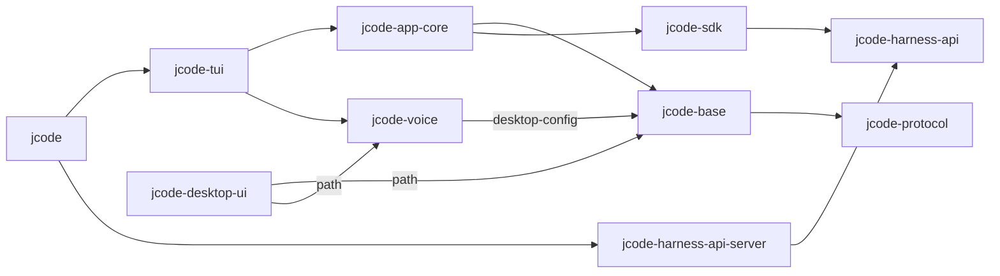

# Время и размер сборки Jcode, 21 ноября 2026

База CLI: `6bbcc7485a287ace2750e4c185b12157a3152a8c`. База Desktop: `dbc14d16b6f0201375acdadd5564c1f14f1abfbf`. Измерения не затрагивали установленное приложение, общий демон или их хранилище сессий.

## Метод

- Нативный `aarch64-apple-darwin`, Rust/Cargo 1.100.0, 14 логических ядер. Два слота `justrust`, текущие Cargo features (`pdf`, `bedrock`), профиль `dev`, четыре задания Cargo. `--locked` фиксирует зависимости. `--rerun` исключает переиспользование вердикта целого запуска. Контроль и опыт запускаются последовательно, не на двух одновременных сборках. Другие задачи на машине не останавливали.
- Холодный прогон означает отсутствующий каталог артефактов, но уже скачанные registry/git sources. Первый разведочный прогон использовал штатный общий depcache. Для профилей контроль и опыт получают отдельные пустые каталоги и отключённые кеши `justrust` (пример ниже).
- Прогретый прогон сначала проверяет no-op. Затем трижды меняется mtime одного и того же `crates/jcode-base/src/config/default_file.rs`. Это прокси инвалидации Cargo, а не замер произвольной правки Rust, и rustc имеет право переиспользовать результаты внутри крейта. Файл входит в число наиболее часто изменявшихся за последние 150 коммитов. Каждый прогон проверяется по `Rebuilt because`, числу юнитов и наличию timing HTML.
- Измеряем `/usr/bin/time -p` (`real`) и `du -sk` одной командой на ARM Mac. Размеры в GiB: KiB, делённые на 1 048 576. Cargo показывает длительность юнита с ожиданием ресурсов, а `justrust show` использует собственные интервалы наблюдения процессов. Длительности отдельных юнитов перекрываются, их нельзя сложить и выдать за время пользователя.

```sh
export JUSTRUST_SLOTS=2 JUSTRUST_DEPCACHE=0 JUSTRUST_LOCALCACHE=0 JUSTRUST_PEER_CACHE=0
# Выполнять в отдельном worktree. RUN_TARGET должен быть новым для холодного прогона.
/usr/bin/time -p justrust build --local='native Darwin compile and disk measurement' \
  --rerun --locked --timings --target-dir "$RUN_TARGET" -j 4 -p jcode --bin jcode
scripts/compile_time_probe.sh --skip-build --timing-html "$RUN_TARGET/cargo-timings/cargo-timing.html"
du -sk "$RUN_TARGET/debug/build" "$RUN_TARGET/debug/incremental" "$RUN_TARGET/debug/jcode" "$RUN_TARGET"
```

## База

`justrust profile --here --days 7` на основном checkout нашёл 545 прогонов: p50 14,48 с, p90 68,79 с, 79,3% суммарного ожидания пришлось на компиляцию. Это смесь команд, машин и состояний кеша. `justrust show` у медленных прогонов `20261115-162141193-36934`, `20261118-171646025-89527`, `20261118-171958956-28954`, `20261118-201239131-62173` показывает, что они не были чистыми замерами одной правки: они пересобирали сотни внешних юнитов. `justrust split --days 7` распознал правки в 297 прогонах (2 959 с компиляции затронутых крейтов и потомков), но его рекомендации по использованию символов нужно сверять с исходниками.

| Разведка со штатными кешами | Wall, с | Компилируемые юниты | Target после cold |
| --- | ---: | ---: | ---: |
| Пустой target, 653 cache hits / 4 misses по depcache | 260,12 | 754 (`justrust`) | 7,03 GiB |
| No-op | 3,36 | 0 | |
| `config/default_file.rs` (base), три прогона | 13,16 / 9,72 / 8,48 | 17 на прогон; 13 localcache hits | |
| `agent.rs` (app-core), один прогон | 4,72 | 4; 3 localcache hits | |
| `tui/ui_messages.rs` (TUI), один прогон | 3,48 | 3; 2 localcache hits | |

В `cargo --timings` холодная сборка 260,00 с. Крупные юниты на критической цепи: `jcode-base` 132,77 с (57,45 до метаданных / 75,32 codegen по разбору HTML), `jcode-app-core` 132,87 с (89,11 / 43,76), `jcode-tui` 55,10 с (36,48 / 18,62), корневая библиотека 22,30 с, бинарь 6,69 с. Они перекрываются, но вместе занимают 232 с от старта base до конца корневой библиотеки. `justrust show 20261121-183034630-65756` также ставит app-core, base и TUI первыми. В холодном `target` 4,50 GiB в `debug/build`, 2,09 GiB в `debug/incremental`, бинарь около 448 MiB. Исторические 9,3/6,1/5,9/2,6 ГБ из общего каталога не сравниваются с одним пустым `target`: там могли накопиться артефакты других feature-наборов, профилей и поколений.

### Связность и размеры

По `cargo metadata --locked --no-deps --format-version=1`: 93 пакета workspace, 288 объявленных прямых рёбер normal path (включая optional и target-specific). `scripts/compile_isolation_report.py` считает тесты вместе с продукционным Rust:

| Крейты | LOC Rust | Файлы | Прямые workspace deps | `derive` | `async_trait` |
| --- | ---: | ---: | ---: | ---: | ---: |
| `jcode-tui` | 309 417 | 642 | 30 | 476 | 26 |
| `jcode-app-core` | 230 598 | 508 | 30 | 395 | 177 |
| `jcode-base` | 195 109 | 405 | 41 | 670 | 34 |
| `jcode` | 57 487 | 119 | 21 | 158 | 5 |
| `jcode-desktop-ui` (sibling checkout) | 173 143 | | | | |

Самые большие группы CLI: `app-core/server` 102 817 строк, `app-core/tool` 69 770, `base/auth` 30 392, `base/provider` 27 039. Из одиночных файлов: `tui/ui_messages.rs` 4 543 строки, `tui/app/input.rs` 4 301, `harness-api-server/translate.rs` 4 271, `app-core/server/client_lifecycle.rs` 4 176. В Desktop `workspace.rs` 17 134, `panel.rs` 12 678, `input.rs` 7 561. LOC не определяет ценность разреза: например, `base/usage` имеет прямые обращения к provider, auth и двум каталогам.



`cargo tree --locked -p jcode -e normal,build -d` показывает две серии `resvg/usvg` (0.46/0.47) и `tiny-skia` (0.11/0.12), `reqwest` 0.12/0.13, `http` 0.2/1, `base64` 0.22/0.23 и три поколения `rand`/`getrandom`. `reqwest 0.13` приходит через `azure_identity → azure_core → typespec_client_core`, а не из собственного разъезда манифестов. `cargo-machete 0.10.1` нашёл только прямые `sha2` и `tokio` в `jcode-telemetry-core` при запуске на `crates/`; обе библиотеки нужны другим крейтам. Это кандидаты на уменьшение связности, не доказанная экономия cold-сборки.

## Очередь экспериментов

1. **Отсоединить форматирование swarm от схемы сокета.** `justrust split` оценивает 130 с потенциальной экономии на 18 исторических изменениях `comm_format`, но ошибается, называя модуль неиспользуемым. Реальные клиенты только `tool/communicate.rs` и `server/comm_await.rs`. Интерфейс уже отделён: существующие `AgentInfo`, `AwaitedMemberStatus` и другие протокольные структуры на входе, `String` на выходе. Отдельный внутренний крейт может читать схему, но схема не должна загружать форматтер. Перенос строк вывода и тестов без редактирования, без изменений serde/wire и без новых типов. Не переносить, если параллельная правка владеет этими файлами.
2. **Размер и время codegen больших крейтов.** На base/app-core/TUI приходится основная часть `incremental`. Проверить 64 вместо 256 CGU только для этих крейтов. Сохранить `debug=line-tables-only` и `incremental=true`. Принять только при уменьшении диска и без уверенного ухудшения инкрементального времени. Добавить соответствующие overrides для dev/test вместе или не добавлять вовсе, чтобы не плодить хеши копий.
3. **Убрать дубликат SVG-стека, если сохранится изображение.** `mermaid-rs-renderer` уже использует `resvg 0.47`. Локальный Mermaid также обрабатывает произвольный SVG. В upstream 0.47 появились variable fonts и `fr` для радиальных градиентов, сменился tiny-skia. Обновление ради одного дубликата не является поведенчески нейтральным без отдельного сравнения растров и проверки входов. Не подменять его единым новым backend с другой семантикой.
4. **Только затем менять generics и derives.** Количество `derive` и `async_trait` не измеряет расходы. Ищем повторяющиеся тела в LLVM IR, проверяем тёплый выигрыш. Серилизуемые типы harness и сессий не переписываем. Не превращаем существующие интерфейсы `dyn Trait` в нативный async trait только ради числа макросов.

В [прошлом аудите](../plans/COMPILE_PERFORMANCE_PLAN.md) уже пробовали разрез provider/auth (10,4 → 10,1 с, откат), Cranelift и `prefer-dynamic` (без выигрыша); перенос `#[cfg(test)]` не ускорял `cargo build`. Embeddings уже opt-in. PDF и Bedrock входят в штатную сборку, поэтому выключение этих features было бы другой задачей, не оптимизацией той же сборки. `build-dir` позволяет перенести кеш, но не уменьшает его. Для Cargo 1.100 нельзя оценивать поколение по старому `debug/deps`: артефакты переехали в `debug/build/<package>/…`.

## Первичные источники

- [The Rust Performance Book: Compile Times](https://nnethercote.github.io/perf-book/compile-times.html), [Cargo timings](https://doc.rust-lang.org/cargo/reference/timings.html), [cargo-llvm-lines](https://github.com/dtolnay/cargo-llvm-lines): timing для очереди и фаз, LLVM IR для количества и размера инстанцирований. Код generic учитывается там, где его инстанцировали, а не обязательно там, где объявили. IR не равен wall time.
- [Cargo Profiles](https://doc.rust-lang.org/cargo/reference/profiles.html), [Features](https://doc.rust-lang.org/cargo/reference/features.html), [Build Cache](https://doc.rust-lang.org/cargo/reference/build-cache.html), [Configuration: build-dir](https://doc.rust-lang.org/cargo/reference/config.html#buildbuild-dir): package overrides, additive feature unification, раздельные build/target dirs и новая раскладка Cargo 1.100. `split-debuginfo` на macOS уже `unpacked` для профилей с debug info.
- Matklad: [Large Rust Workspaces](https://matklad.github.io/2021/08/22/large-rust-workspaces.html) и [Fast Rust Builds](https://matklad.github.io/2021/09/04/fast-rust-builds.html). Широкий граф позволяет переиспользовать независимые ветви, последовательное выделение крейтов только удлиняет цепочку.
- [rust-analyzer Architecture](https://rust-analyzer.github.io/book/contributing/architecture.html): `syntax` не зависит от остального анализатора, а интерфейс между подсистемами выражает инварианты. Это пример локальности, не число, переносимое в Jcode.
- [Zed: Building for macOS](https://zed.dev/docs/development/macos#avoiding-continual-rebuilds): даже разные переменные окружения `cargo run` и IDE инвалидируют артефакты. Поэтому параметры замера фиксируем, IDE и демон не используем для запуска benchmark.
- [Bevy: Enable Fast Compiles](https://bevy.org/learn/quick-start/getting-started/setup/#enable-fast-compiles): динамическая линковка как opt-in для dev, не рекомендация менять поставку; на macOS руководство отдельно отмечает `ld-prime`. Здесь Cargo измеряет, где линковка действительно доминирует.
- [resvg changelog 0.47.0](https://github.com/linebender/resvg/blob/main/CHANGELOG.md#0470-2026-02-05), [cargo-machete](https://github.com/bnjbvr/cargo-machete): поведение SVG изменилось; статической находки недостаточно для удаления реальной зависимости.
