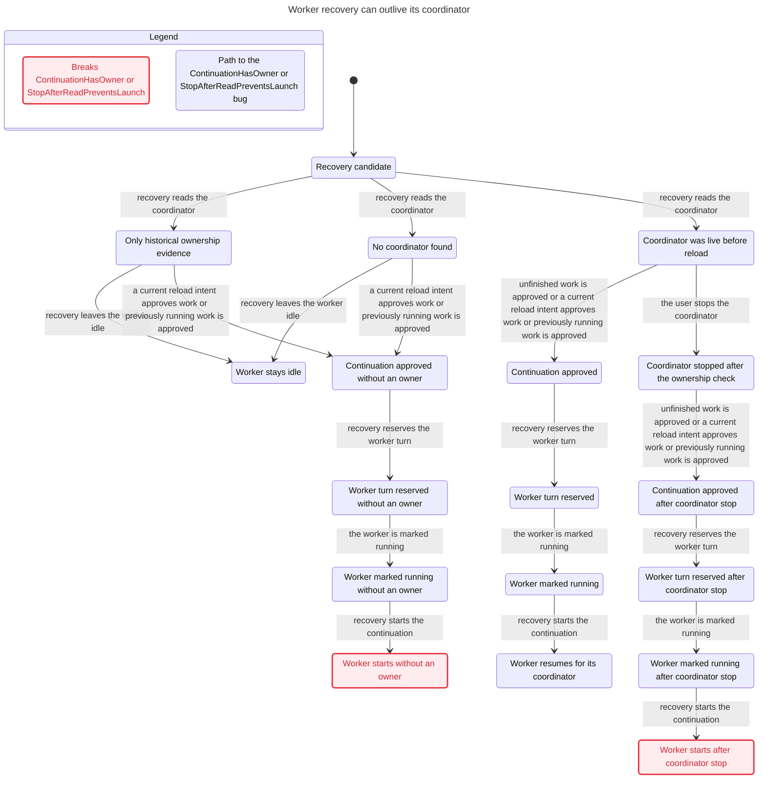

# Владение воркерами после reload

Проверено 16 ноября 2026 года. Цель проверки состоит в том, чтобы остановленный координатор не оставлял незаметно работающих воркеров.

## Что найдено

1. `ContinuationHasOwner` нарушается. Если воркер был running перед перезапуском и его история содержит признак прерванной работы, recovery запускает его даже при старом stopped-координаторе. Текущий reload-intent тоже обходит проверку владельца. Для последнего обхода уже существует положительный тест, поэтому это явно разрешённое поведение, расходящееся с проверяемым контрактом.
2. `StopAfterReadPreventsLaunch` нарушается. Recovery читает владельца, затем освобождает members lock. Координатора останавливают, каскадная отмена не находит ещё не созданного turn. Recovery использует сохранённое разрешение и запускает воркера после stop.

Оба пути воспроизведены в настоящем `Server::recover_headless_sessions_on_startup`, а не только в модели. Тесты `formal_recovery_running_worker_requires_owner` и `formal_recovery_stop_after_owner_read_prevents_continuation` завершаются соответствующим assertion failure. Они помечены ignored, потому что продуктовый код в этой задаче не исправляется. Таймаут или ошибка компиляции не считаются воспроизведением.

Это доказывает возможность продолжения генерации. Проверка не доказывает запись файла, не воспроизводит конкретный пользовательский reload и не проверяет оставшиеся дочерние процессы.

## Кратчайшие пути

TLC 1.7.4 через /statechart обошёл 86 состояний и 90 переходов. Это полный конечный граф этой модели, а не всех состояний Jcode.

Путь `ContinuationHasOwner` содержит пять шагов после начального состояния.

0. Воркер выбран для recovery.
1. Прочитан исторический владелец, не признанный живым.
2. Предыдущее running-состояние разрешает продолжение.
3. Захвачен turn воркера.
4. Воркер отмечен running.
5. Продолжение запущено без владельца.

Путь `StopAfterReadPreventsLaunch` содержит шесть шагов после начального состояния.

0. Воркер выбран для recovery.
1. Владелец признан живым на границе reload.
2. Координатор остановлен. Каскадная отмена до изменения статуса не находит turn.
3. Незавершённая работа разрешена по старому результату проверки.
4. Захвачен turn воркера.
5. Воркер отмечен running.
6. Продолжение запущено после stop.

На диаграмме `Worker starts without an owner` нарушает `ContinuationHasOwner`. Состояние `Worker starts after coordinator stop` нарушает оба свойства. Скрыты только 16 переходов, остающихся в том же отображаемом состоянии, включая терминальные self-loop.

## Проверка намеренной поломкой

В scratch-копии настоящего `server.rs` условие `live_before_restart.contains(&member.session_id)` заменено на `true`. Изменённая функция действительно скомпилирована, её результаты переданы модели. Дополнительно нарушилось `HistoricalEvidenceCannotAuthorize`. После экспорта нетронутого исходника это свойство снова выполняется, а две исходные находки остаются. Удаление проверки поймано по поведению, а не только по hash или diff файла.

Выполните `python3 verification/recovery/check.py --mutation-test`. Успешный exit 0 подтверждает чувствительность проверки. Обычный `python3 verification/recovery/check.py` возвращает exit 1, пока исходные находки остаются.

## Проверки и ограничения

- В модели один воркер, один найденный координатор, один restart и один stop между чтением владельца и решением о продолжении. Полные границы описаны в `README.md`.
- Историческая запись сама по себе не разрешает запуск. `HistoricalEvidenceCannotAuthorize`, `TypeOK` и отсутствие тупиков проходят на нетронутом коде.
- После rebase семь существующих startup recovery tests проходят, два новых ignored replay падают только на проверяемых assertions. Восемь Python-тестов проверяют извлечение исходника, независимый запуск свойств, обработку ошибок TLC и checksum инструмента.
- Обычный clippy проходит с исходными предупреждениями. После rebase strict clippy с `-D warnings` останавливается на `collapsible_if` в неизменённом `crates/jcode-provider-openrouter-runtime/src/lib.rs:515`. Предупреждения не подавлялись в продукте.
- Проверки test isolation, cell-width chrome и форматирования проходят. Живой пользовательский сервер не перезагружался.

Model the Domain определил выбор явных состояний владения и admission. Prove It Works потребовал реальных server-replay и поломки настоящего Rust guard вместо одной диаграммы.

## Диаграмма

